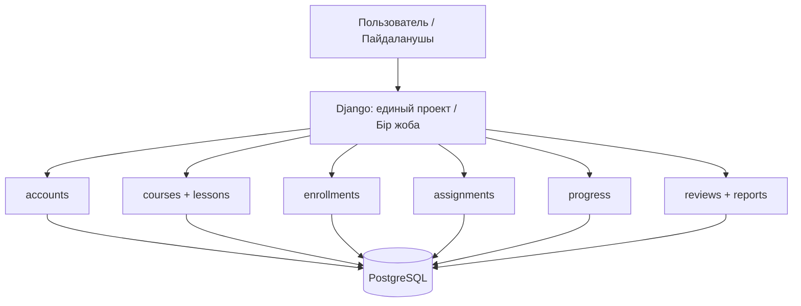
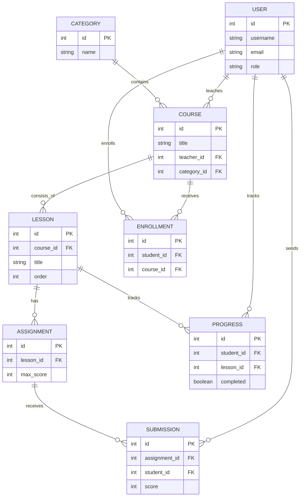

# Диаграммы / Диаграммалар

## Общая архитектура / Жалпы сәулет

## Концептуальная ER-диаграмма / ER диаграммасы

Схема предварительная. Отзывы, комментарии, материалы и конкретная структура тестов будут уточнены при проектировании MVP.

Диаграмма — концептуальная, қазіргі төрт модельдің кестелері жергілікті SQLite дерекқорында жасалды; PostgreSQL-дегі толық схема әлі жоспар ретінде көрсетілген.

Бұл алдын ала жасалған схема. Пікірлер, материалдар және тест құрылымы келесі кезеңде нақтыланады; нақты кестелер әлі жасалған жоқ.
